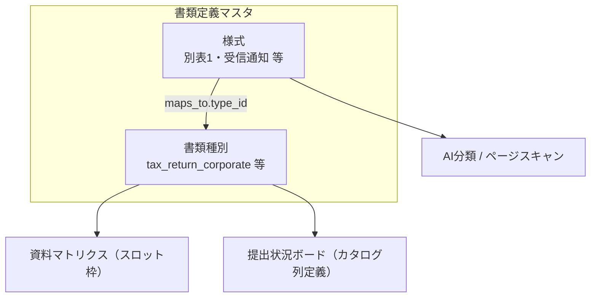

# 書類定義の用語整理（種別 / 様式 / レポート）

最終更新: 2026-07-13

DocuGrid では「書類」に関する設定が **3つの異なる概念** に分かれています。名前が似ていたため混乱しやすかったので、ここで用語とデータの所在を固定します。

関連: [`common-pitfalls.md`](common-pitfalls.md)、[`document-catalog-vision.md`](document-catalog-vision.md)、[`platform-packs-vision.md`](platform-packs-vision.md)（正規化のパック化・API/MCP 公開の構想）

---

## 用語一覧

| 用語（画面名） | 旧名称 | 実体 | データソース | 編集 |
|----------------|--------|------|--------------|------|
| **書類種別マスタ** | 書類カテゴリ定義 | 大分類（定款・法人税申告書…）＋ OCR/Dashboard/Alert フラグ | `backend/config/document_types.yaml` | 開発コンソール → 書類定義マスタ → 書類種別 |
| **様式・AI分類ルール** | 書類マスタ（AI分類） | 受信通知・別表など PDF 内の様式検出ルール | `backend/config/form_catalog.yaml` | 開発コンソール → 書類定義マスタ → 様式・AI分類 |
| **提出状況ボード** | 書類カタログ | 顧問先横断の**提出実績**レポート（定義ではない） | 実データ（slot_documents 等） | 閲覧のみ |

**連携ポートカタログ**・**法定マスタ**は別系統（API 連携 port_id / 税率 CSV）であり、上記3つとは無関係です。

---

## 2段構成（種別 × 様式）

- **書類種別**: マトリクスの行・スロット ID（例: `tax_return_corporate` = 法人税申告書）
- **様式**: 1つの PDF パッケージ内の個別帳票（別表15、受信通知…）。`form_id` で識別し、`maps_to.type_id` で種別に紐付ける

---

## API

| 用途 | エンドポイント |
|------|----------------|
| 種別一覧（業務画面） | `GET /api/document-types` |
| 種別一覧（開発） | `GET /api/dev/document-types` |
| 提出状況ボード用カテゴリ | `GET /api/document-catalog/fields`（種別マスタの catalog.enabled 由来） |
| 提出実績データ | `GET /api/document-catalog?category_id=...` |

---

## 移行メモ

- `frontend/src/config/organization.ts` の `DOCUMENT_CATEGORIES` は **フォールバック**。正本は `document_types.yaml`。
- `document_catalog_service.CATALOG_SPECS` は **廃止**（`document_types` から生成）。
- `form_catalog.yaml` の `maps_to` には `type_id` を推奨。未設定時は `category` / `slot_label` からエイリアス解決（`resolve_type_id_from_maps_to`）。

---

## 画面の行き方

1. **大分類を確認・編集したい** → 開発コンソール → 書類定義 → **書類種別**（または 事務所設定 → 書類種別）
2. **別表・受信通知の検出ルール** → 開発コンソール → 書類定義 → **様式・AI分類**
3. **誰が何を提出したか見たい** → 開発コンソール → 業務レポート → **提出状況ボード**（`/catalog`）
