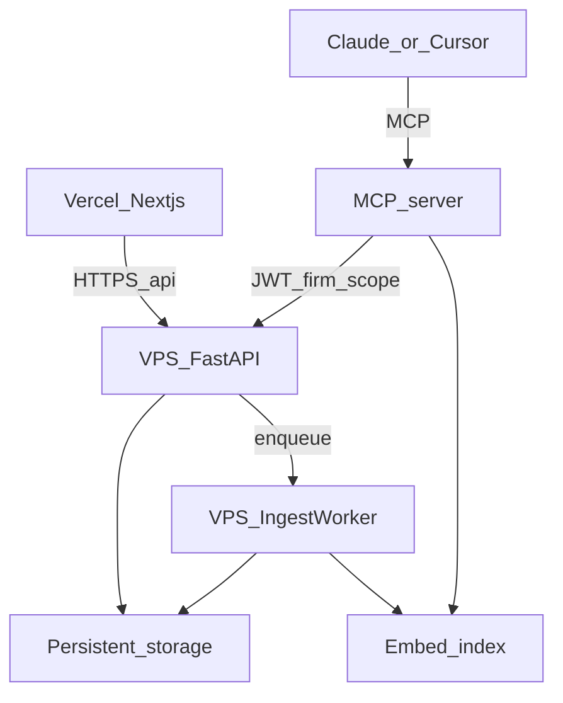

# DocuGrid 今後プラン — 本番ホストと OCR → RAG → MCP

最終更新: 2026-08-03  
ステータス: 正本（実装前の合意用）。製品全体の P0–P5 は [`roadmap.md`](roadmap.md) を参照。

本書は次の2軸を **実装可能なフェーズ** に落とす。

1. **本番ホスト**（Vercel + VPS）
2. **データパイプライン（OCR / RAG）と MCP インターフェース**

正規化データ・定義パックの本線は [`platform-packs-vision.md`](platform-packs-vision.md)。RAG はその **検索レイヤ** であり、正規化の代替ではない。

---

## 0. 前提・非ゴール

| 項目 | 決定 |
|------|------|
| ランタイム | `frontend/`（Next.js）+ `backend/main.py`（FastAPI）+ `mcp-server/` |
| 対象外 | `backend/core/`（会計トラック） |
| ホスト | **Vercel 一本は不可**（SQLite / PDF がローカルディスク依存）。フロント = Vercel、API / worker / インデックス = **日本リージョン VPS + Docker 永続ボリューム** |
| 初期キュー | Celery / Redis / Qdrant を最初から全部入れない。VPS 上の **単一 ingest worker** + 埋め込みストアから始める |
| 権限 | フロントだけのフィルタ禁止。検索・OCR トリガーもサーバー側で `firm_id` / `authorize_client_access` |

ホスティングの記入・DNS 手順: [`hosting-decision.md`](hosting-decision.md)  
デプロイ手順: [`production-deployment.md`](production-deployment.md)  
精度実験ログ（ノーコード）: 設定 → AI / MCP ラボ → [`accuracy-lab-findings.md`](accuracy-lab-findings.md)

---

## 1. 目標アーキテクチャ



処理の2軸:

```text
[ DocuGrid 内データ ]
        │  定期 / 版作成イベント
        ▼
[ 1. OCR & テキスト抽出パイプライン ]
        │
        ▼
[ 2. 埋め込みインデックス（RAG） ]
        ▲
        │  コンテキスト検索（firm/client 先絞り）
[ 3. MCP Tools / Resources ]
        ▲
        │  MCP Protocol
[ LLM クライアント（Claude Desktop / Cursor 等） ]
```

不変条件（既存 tenancy と同じ）:

- MCP は [`mcp-server/src/guards.ts`](../mcp-server/src/guards.ts) の user scope を維持する
- RAG ヒットも他 firm / 非可視 client を返してはならない
- 詳細: [`auth-tenancy-design.md`](auth-tenancy-design.md)、[`security-checklist.md`](security-checklist.md) §D

---

## 2. フェーズ計画（実装順固定）

| Phase | Done when | 主な成果物 |
|-------|-----------|------------|
| **H** Host | `https://app.` / `https://api.` で本番スモーク通過 | Vercel + VPS、本番 env（`bootstrap:production` / `validate_production_env.py`） |
| **I0** Index state | version に `content_sha256` / `ocr_status` / `indexed_at` が残り、再処理が冪等 | DB/メタ拡張、重複実行防止 |
| **I1** MCP thin window | Cursor から get / list / trigger / status が既存 API 経由で動く | [`mcp-server/src/tools.ts`](../mcp-server/src/tools.ts) 拡張（ベクトル検索なし） |
| **I2** Minimal RAG | 「顧客 × キーワード」で **firm 内のみ** ヒットし、抜粋 + メタを返す | ingest worker、チャンク、埋め込み、VPS 上の単一プロセス + ファイル/SQLite ベクトル表 |
| **I3** Quality | 低信頼ページのみ VLM、ハイブリッド検索（ベクトル + キーワード） | 既存 Vision 分類経路の再利用、評価メモ |

### H — 本番ホスト

契約の最小セット:

| 何 | 契約 |
|----|------|
| 画面 | Vercel（Hobby から可） |
| API + データ | 日本リージョン VPS 1 台（目安 2GB RAM / 40GB SSD）+ Docker |
| DNS | 既存ドメインで `app` → Vercel、`api` → VPS |
| ログイン | Google OAuth（本番） |
| 課金 | Stripe は課金開始時 |

メモ: `@lext-tax.com` は課金免除ドメイン（[`stripe_billing_service.is_billing_exempt_email`](../backend/services/stripe_billing_service.py)）。Host フェーズの運用確認に使うが、本書の実装スコープ外。

### I0 — インデックス状態

- インジェストキーは document version の **`content_sha256`**（[`document_version_service.py`](../backend/services/document_version_service.py)）
- 状態例: `pending` / `processing` / `ready` / `failed`
- 全件再 OCR しない。未処理・更新検知のみキュー投入

### I1 — MCP の薄い窓（RAG なし）

既存 classify / file / catalog API を窓にする。初期ツール:

| Tool | 役割 |
|------|------|
| `get_document` | 指定資料のメタ・テキスト抜粋（あれば） |
| `list_ocr_status` | 未完了・失敗一覧 |
| `trigger_ocr` | 特定 version / file をキュー投入 |
| `search_internal_docs` | I1 ではメタキーワードのみ可。I2 でベクトル |

Resource URI（I2 以降）: `docugrid://documents/{id}`

### I2 — 最小 RAG

- チャンク: ノイズ除去後、見出し・表を意識した Markdown 寄り分割
- Embedding: `text-embedding-3-small` または同等の日本語対応モデル
- ストア: **VPS 上の単一プロセス + ファイル/SQLite ベクトル表**。境界を切り、後で pgvector / Qdrant へ移行可能にする
- メタ必須: `firm_id`, `client_id`, `doc_id`, `version_id`, `content_sha256`
- 検索順序: **メタで firm/client を先に絞る → 類似度**

### I3 — 品質とコスト

- 通常は既存 PyMuPDF / Tesseract / 分類経路。低信頼・表潰れのみ Vision LLM
- 全ページ VLM 禁止（コスト）
- AI 利用量は既存 AI usage / Stripe AI 枠と整合（[`stripe-production-setup.md`](stripe-production-setup.md)）

---

## 3. 既存コードとの接続点

| 関心 | 接続先 | 方針 |
|------|--------|------|
| OCR / 抽出 | classify / capture（PyMuPDF・Tesseract・Vision） | **再発明しない**。worker から既存サービスを呼ぶ |
| 版・ハッシュ | `document_version_service` | インジェストの冪等キー |
| 顧客カルテ | `client_karte_service` / `GET .../karte/rag-chunks` | 打合せ・期末・永続メモをテキストチャンク化済み。I2 の追加ソースにする |
| MCP 認可 | `mcp-server/src/guards.ts`, `session.ts` | 既存 JWT / visible_client_ids |
| 正規化・パック | `platform-packs-vision.md`, `config/*.yaml` | RAG は検索。抽出スキーマは別ライン |
| roadmap P3 | OCR → 振り分け | 本プランの I0–I2 は P3 を **検索・MCP 向けに拡張**する次章 |

---

## 4. セキュリティ・コスト

1. **権限フィルタ必須** — ベクトル類似度より先に firm / client スコープ
2. **差分 + ハッシュ** — 重複 OCR・重複埋め込みを防ぐ
3. **秘密情報** — 埋め込み API キーは VPS env のみ。MCP 経由でブラウザに出さない
4. **IDOR** — `get_document` / `trigger_ocr` は resource → client → firm の順で認可（既存 API と同型）

---

## 5. 出口チェックリスト

- [ ] **H**: [`production-smoke-checklist.md`](production-smoke-checklist.md) を本番 URL で実施
- [ ] **I0**: 同一 sha256 の再投入が no-op
- [ ] **I1**: MCP で未インデックス一覧 → `trigger_ocr` → status 更新
- [ ] **I2**: 他 firm の文書が検索に出ない（pytest + MCP 手動）
- [ ] **リンク**: `AGENTS.md` / `roadmap.md` / `hosting-decision.md` から本書へ辿れる

最初の Done 定義（I2）:

> Cursor から「この顧客の源泉徴収票を探して」→ firm 内だけヒット → 原文メタと抜粋が返る。未インデックスなら `trigger_ocr` で後から検索可能になる。

---

## 関連ドキュメント

| ファイル | 関係 |
|----------|------|
| [`roadmap.md`](roadmap.md) | 製品フェーズ P0–P5 の正本。本書は Host + OCR/RAG/MCP 次章 |
| [`platform-packs-vision.md`](platform-packs-vision.md) | 正規化・定義パック・API/MCP 公開 |
| [`hosting-decision.md`](hosting-decision.md) | Vercel + VPS の決定メモ |
| [`production-deployment.md`](production-deployment.md) | 本番デプロイ手順 |
| [`api-contract.md`](api-contract.md) | HTTP 契約（新エンドポイント時に同更新） |

---

## 変更履歴

| 日付 | 内容 |
|------|------|
| 2026-08-03 | 初版 — Host + I0–I3、アーキテクチャ、接続点、セキュリティ |
