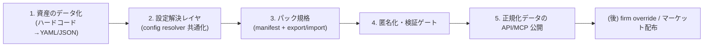

# プラットフォーム化構想 — 定義パック・正規化カスタマイズ・データ公開（API/MCP）

最終更新: 2026-07-13（初版・構想）
ステータス: 構想（vision）。実装は開発側ベースから段階着手。

DocuGrid を「機能の集合」から「**事務所がルール・教師データを育てて配布できる基盤**」へ広げるための構想。
本書は方針の正本。実装時の判断はここに合わせる。

関連: [`extensibility-principles.md`](extensibility-principles.md)、[`ssot-normalization.md`](ssot-normalization.md)、[`document-taxonomy.md`](document-taxonomy.md)、[`no-code-config-vision.md`](no-code-config-vision.md)、[`auth-tenancy-design.md`](auth-tenancy-design.md)、[`common-pitfalls.md`](common-pitfalls.md)、[`crm-packs-vision.md`](crm-packs-vision.md)（汎用 CRM × 保険／不動産パック）

---

## 1. ゴール

1. 各事務所が **書類定義・分類ルール・正規化（抽出）ルール** を工夫できる。
2. それを個人情報を除いた **「定義パック」** として配布・販売できる。
3. 正規化済みデータを **API / MCP** から作業しやすい形で取り出せる。
4. 上記を **既存を壊さず** 足せる（`extensibility-principles.md` E1–E6 に従う）。

「これに限らず」— 同じ階層・パックの仕組みを他の資産（チェックリスト、ひな形、指標マップ）にも横展開する。

---

## 2. いま着手する順番（重要）

> **最初は事務所別カスタマイズより先に、開発側でベースを固める。**



- **Phase B1–B5 は開発側（global/built-in）で完結する。** firm override とマーケット配布はその後。
- firm 別カスタマイズを急がないことで、規格が固まる前に事務所データが分散するのを防ぐ。

---

## 3. 対象資産（パック化できるもの）

| 資産 | 現在の所在 | データ化状況 | パック相性 |
|------|------------|--------------|-----------|
| 書類種別マスタ | `backend/config/document_types.yaml` | 済 | ◎ |
| 様式・AI分類ルール | `backend/config/form_catalog.yaml` | 済 | ◎ |
| 抽出スキーマ（正規化） | `backend/data/extraction_schemas/*.json` + `profile_extractors.py`（一部コード） | **一部コード**（要データ化） | ◎ |
| 指標マップ | metric-mappings（dev tool） | 済 | ○ |
| AI分類プロンプト | `ai_prompts`（firm/global/built-in 階層済み） | 済 | ○ |
| 監査チェックリスト | review_checklist | 済 | ○ |
| 文書ひな形 | authoring_templates | 済 | ○ |
| 法定マスタ（税率等） | Temporal CSV | 済 | △（公式配布向き） |

**B1 の主眼:** `profile_extractors.py` のハードコード抽出を `extraction_schemas/*.json` に寄せきり、正規化を完全にデータ駆動にする。

---

## 4. 設定解決レイヤ（config resolver）

`ai_prompts` が既に持つ多層フォールバックを **共通関数として抽出** し、全資産で使い回す。

```
firm override            事務所が追加/上書き（後フェーズ）
  > installed package     インストールした定義パック
    > global default      DocuGrid 標準（config/*.yaml, data/*.json）
      > built-in          コード内フォールバック
```

- 解決結果には **provenance（どの層由来か）** を必ず付ける（デバッグ・監査・UI表示用）。
- firm スコープは必ず JWT の `firm_id`。パックのインストール状態も `firm_id` 単位。
- 開発側ベースでは `global` と `built-in` の2層だけ動けばよい（`package`/`firm` は後付け）。

---

## 5. 定義パックの規格（manifest）

1パックが複数資産を束ねられる形にする。

```yaml
package_id: corp-tax-eltax-standard
version: 1.2.0
author: docugrid-official        # or 事務所ID
license: proprietary             # or cc-by / internal
title: 法人税申告書（e-Tax標準）パック
supported_document_types: [tax_return_corporate]
provides:
  document_types: [...]          # 書類種別
  form_catalog: [...]            # 様式・AI分類ルール
  extraction_schemas: [...]      # 正規化ルール
  metric_maps: [...]             # 指標マッピング
contains_samples: false          # サンプルPDF同梱の有無
anonymized: true                 # 匿名化ゲート通過フラグ
```

- **配布してよいもの:** form_id、帳票名、アンカー語、must_not、filename_hints、page_scan、maps_to.type_id、必須/任意、抽出パターン（正規表現）、confidence 閾値、ページ注釈、プロンプト改善文。
- **配布に注意:** 顧問先名入りPDF、OCR全文、税額・住所・法人番号・利用者識別番号、個人情報を含むファイル名。
- 販売単位は「PDFそのもの」ではなく **サンプルから抽象化したルール**。

---

## 6. 匿名化・検証ゲート

- **Export 時:** 個人情報・顧問先名・数値実額を除去。`anonymized: true` を立てる。落とし切れない項目は警告してブロック。
- **Import 時:** manifest schema 検証 + 各資産の schema 検証（既存の `validate_*` を再利用）。firm スコープに閉じてインストール。
- 情報漏洩ルールは [`common-pitfalls.md`](common-pitfalls.md) §A と直結。テストで「機微値が pack に混入しない」ことを担保。

---

## 7. 正規化データの API / MCP 公開

正規化済み SSOT を **作業しやすい形** で外部に開く。フロント専用の隠し API は作らない（E2）。

### 7.1 API（契約優先）

想定エンドポイント（`api-contract.md` に追記してから実装）:

| 用途 | 例 |
|------|-----|
| 顧問先の正規化プロフィール取得 | `GET /api/clients/{client_id}/normalized-profile` |
| フィールド由来（provenance）付き取得 | `?include=provenance` |
| 期間指標の取得 | `GET /api/clients/{client_id}/metrics?period_key=...` |
| 書類種別ごとの提出+抽出状況 | 既存 `GET /api/document-catalog` を拡張 |
| 抽出結果の確定反映 | 既存 `POST /api/extraction/apply` |

- レスポンスは **値 + source + confidence + updated_at** を含む（human override 優先の原則を維持）。
- すべて `firm_id` / `client_id` スコープをサーバーで強制（`authorize_client_access`）。

### 7.2 MCP

`mcp-server/src/tools.ts` にツールを追加（`guards.ts` の firm/client スコープを踏襲）。

想定ツール:

- `get_normalized_profile(client_id)` — 正規化プロフィール＋provenance
- `list_client_metrics(client_id, period_key)` — 経営指標
- `get_document_status(client_id, period_key)` — 提出状況ボード相当
- `search_clients(query)` — 既存の顧客検索に整合

MCP ガード不変条件（[`security-checklist.md`](security-checklist.md) §D）:
- トークンの `firm_id` とリソースの `firm_id` 一致を必須。
- 書き込み系ツールは権限（`document.upload` 等）を要求。
- 個人情報の取り扱いは API と同一ポリシー。

---

## 8. 段階ロードマップ（開発側ベース優先）

| Phase | 内容 | スコープ | 完了条件 |
|-------|------|----------|----------|
| **B1** | `profile_extractors` を `extraction_schemas` JSON に寄せきる | global/built-in | 全 slot がデータ駆動、既存テスト緑 |
| **B2** | config resolver 共通化（`ai_prompts` から抽出） | global/built-in | 2資産以上が共通解決を使用、provenance 付与 |
| **B3** | パック manifest 規格 + export/import（global パックのみ） | global | 公式パックを export→import で往復可能 |
| **B4** | 匿名化・検証ゲート | global | 機微値混入をテストでブロック |
| **B5** | 正規化データ API + MCP ツール | global | `api-contract.md` 更新済み・MCP guard テスト緑 |
| C（後） | firm override（まず抽出スキーマ or form_catalog） | firm | firm 単位で上書き・provenance 表示 |
| D（後） | パック配布/販売（マーケット） | package | インストール・課金・ライセンス |

---

## 9. 不変条件（この構想で守ること）

1. **開発側ベース（global/built-in）を先に完成させる。** firm/package は後付けで、規格が固まるまで事務所データを分散させない。
2. 設定は必ず多層解決 + provenance。human override 優先は正規化の既存原則を維持。
3. パック配布はルールの抽象化物。個人情報・PDF実体は既定で含めない。
4. API/MCP は契約優先・`firm_id` スコープ必須・フロント専用の隠し API 禁止。
5. 追加はデフォルト、既存 SSOT の意味変更は ADR（E5）。
